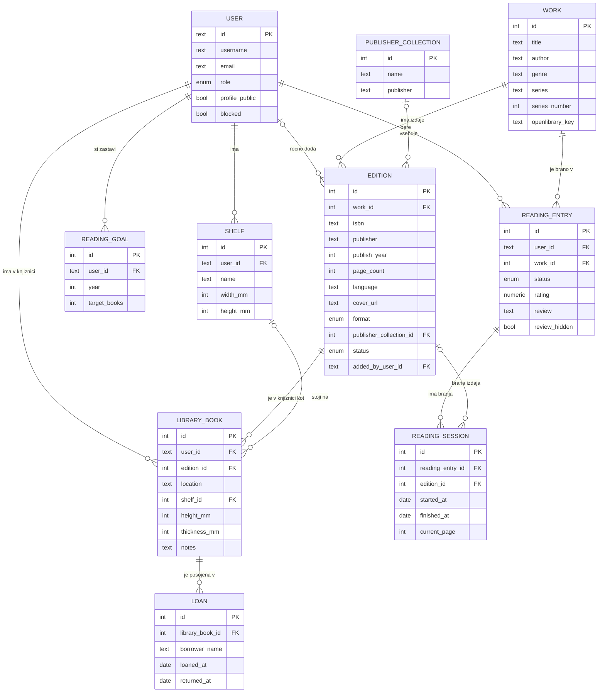

# Podatkovni model

Aplikacija uporablja relacijsko podatkovno bazo (PostgreSQL), ker so podatki mocno povezani (uporabnik – knjiga – izvod – posoja) in so pomembne omejitve, kot so tuji kljuci in unikatnost.

## Entitete

### User (uporabnik)

| Polje          | Tip            | Opis                                                                        |
| -------------- | -------------- | --------------------------------------------------------------------------- |
| id             | int, PK        |                                                                             |
| username       | text, unikatno | prikazano na javnem profilu                                                 |
| email          | text, unikatno | za prijavo                                                                  |
| password_hash  | text           | zgoscena vrednost gesla                                                     |
| role           | enum           | `user` / `admin` (obiskovalec nima racuna)                                  |
| profile_public | bool           | ali je profil (knjiznica, branje, ocene, recenzije) javen; privzeto `false` |
| blocked        | bool           | nastavi administrator                                                       |
| created_at     | datetime       |                                                                             |

### Work (delo)

Knjiga kot vsebina, neodvisno od izdaje.

| Polje           | Tip                | Opis                                               |
| --------------- | ------------------ | -------------------------------------------------- |
| id              | int, PK            |                                                    |
| title           | text               | naslov                                             |
| author          | text               | avtor                                              |
| genre           | text               | zanr                                               |
| series          | text, lahko prazno | serija, npr. "Harry Potter"                        |
| series_number   | int, lahko prazno  | zaporedna stevilka v seriji                        |
| description     | text               | opis                                               |
| openlibrary_key | text, lahko prazno | kljuc dela v Open Library (npr. `/works/OL66554W`) |

### Edition (izdaja)

Konkretna izdaja dela. Podatki pridejo iz Open Library, iz uvoza Goodreads ali z rocnim vnosom.

| Polje                   | Tip                                    | Opis                                                  |
| ----------------------- | -------------------------------------- | ----------------------------------------------------- |
| id                      | int, PK                                |                                                       |
| work_id                 | FK → Work                              |                                                       |
| isbn                    | text, unikatno, lahko prazno           | starejse knjige ga nimajo                             |
| publisher               | text                                   | zalozba                                               |
| publish_year            | int                                    | leto izdaje                                           |
| page_count              | int                                    | stevilo strani                                        |
| language                | text                                   | jezik                                                 |
| cover_url               | text                                   | naslovnica, npr. iz Open Library Covers API           |
| format                  | enum                                   | `print` / `ebook` / `audiobook`                       |
| publisher_collection_id | FK → PublisherCollection, lahko prazno | knjizna zbirka, v kateri je izdaja                    |
| status                  | enum                                   | `approved` / `pending` (rocni vnos caka na potrditev) |
| added_by_user_id        | FK → User, lahko prazno                | kdo je izdajo rocno dodal                             |

### PublisherCollection (knjizna zbirka)

Zbirka zalozbe, npr. Penguin Clothbound Classics.

| Polje     | Tip            | Opis       |
| --------- | -------------- | ---------- |
| id        | int, PK        |            |
| name      | text, unikatno | ime zbirke |
| publisher | text           | zalozba    |

### LibraryBook (knjiga v knjiznici)

Izdaja, ki jo ima uporabnik v lasti. Knjiznica uporabnika so vsi njegovi zapisi `LibraryBook`; format in knjizna zbirka se preberejo iz izdaje.

| Polje        | Tip                      | Opis                                                   |
| ------------ | ------------------------ | ------------------------------------------------------ |
| id           | int, PK                  |                                                        |
| user_id      | FK → User                | lastnik                                                |
| edition_id   | FK → Edition             |                                                        |
| location     | text                     | lokacija, npr. "dnevna soba, polica 2" (vedno zasebno) |
| notes        | text                     | opombe (vedno zasebno)                                 |
| added_at     | datetime                 |                                                        |
| shelf_id     | FK → Shelf, lahko prazno | polica, na kateri knjiga stoji (nacrtovalec polic)     |
| height_mm    | int, lahko prazno        | visina knjige v milimetrih; samo za tiskane knjige     |
| thickness_mm | int, lahko prazno        | debelina hrbta v milimetrih                            |

### Shelf (polica)

Polica v uporabnikovem domu, ki jo uporablja nacrtovalec polic.

| Polje     | Tip       | Opis                                    |
| --------- | --------- | --------------------------------------- |
| id        | int, PK   |                                         |
| user_id   | FK → User |                                         |
| name      | text      | npr. "dnevna soba, omara 1, polica 3"   |
| width_mm  | int       | dolzina police v milimetrih             |
| height_mm | int       | visina prostora nad polico v milimetrih |

### Loan (posoja)

| Polje           | Tip                | Opis                                          |
| --------------- | ------------------ | --------------------------------------------- |
| id              | int, PK            |                                               |
| library_book_id | FK → LibraryBook   |                                               |
| borrower_name   | text               | komu je posojena (izposojevalec nima racuna)  |
| loaned_at       | date               | datum posoje                                  |
| returned_at     | date, lahko prazno | datum vrnitve; prazno = knjiga je se posojena |

### ReadingEntry (bralni vnos)

Odnos uporabnika do dela: status, ocena in recenzija. Neodvisno od lastnistva, ker uporabnik bere tudi knjige, ki jih nima (iz knjiznice, izposojene).

| Polje         | Tip                        | Opis                                          |
| ------------- | -------------------------- | --------------------------------------------- |
| id            | int, PK                    |                                               |
| user_id       | FK → User                  |                                               |
| work_id       | FK → Work                  |                                               |
| status        | enum                       | `want_to_read` / `reading` / `read`           |
| rating        | numeric(3,2), lahko prazno | ocena od 0 do 5 v korakih po 0.25 (npr. 3.75) |
| review        | text, lahko prazno         | recenzija                                     |
| review_hidden | bool                       | recenzijo skril administrator                 |

### ReadingSession (branje)

Posamezno branje dela. Ce uporabnik knjigo prebere veckrat, ima en `ReadingEntry` in vec zapisov `ReadingSession`.

| Polje            | Tip                        | Opis                                       |
| ---------------- | -------------------------- | ------------------------------------------ |
| id               | int, PK                    |                                            |
| reading_entry_id | FK → ReadingEntry          |                                            |
| edition_id       | FK → Edition, lahko prazno | katero izdajo je bral (npr. e-knjigo)      |
| started_at       | date, lahko prazno         | datum zacetka                              |
| finished_at      | date, lahko prazno         | datum zakljucka; prazno = branje se poteka |
| current_page     | int, lahko prazno          | trenutna stran pri branju, ki se poteka    |

### ReadingGoal (bralni cilj)

| Polje        | Tip       | Opis                           |
| ------------ | --------- | ------------------------------ |
| id           | int, PK   |                                |
| user_id      | FK → User |                                |
| year         | int       | leto                           |
| target_books | int       | ciljno stevilo prebranih knjig |

## Povezave med entitetami

- **Work 1 : N Edition** – eno delo ima lahko vec izdaj (razlicne zalozbe, leta, jeziki).
- **Edition 1 : N LibraryBook** – ista izdaja je lahko v knjiznicah vec uporabnikov.
- **User 1 : N LibraryBook** – uporabnik ima v knjiznici vec knjig; ima lahko tudi vec izdaj istega dela (npr. dve razlicni tiskani izdaji ali tiskano in e-knjigo).
- **PublisherCollection 1 : N Edition** – izdaja je lahko v eni knjizni zbirki ali v nobeni.
- **User 1 : N Shelf** – uporabnik ima vec polic.
- **Shelf 1 : N LibraryBook** – na polici je vec knjig; knjiga je lahko na eni polici ali na nobeni.
- **LibraryBook 1 : N Loan** – knjiga je bila lahko veckrat posojena; hkrati je lahko aktivna najvec ena posoja.
- **User 1 : N ReadingEntry** in **Work 1 : N ReadingEntry** – ReadingEntry povezuje uporabnika in delo (M : N med uporabniki in deli).
- **ReadingEntry 1 : N ReadingSession** – vsako (ponovno) branje istega dela je svoj zapis.
- **Edition 1 : N ReadingSession** – opcijsko: branje se lahko poveze z izdajo, ki jo je uporabnik bral.
- **User 1 : N ReadingGoal** – en cilj na leto.
- **User 1 : N Edition** (rocno dodane) – opcijska povezava `added_by_user_id`.

## Pravila in omejitve

- `ReadingEntry`: par (user_id, work_id) je unikaten – za vsako delo ima uporabnik en status, eno oceno in eno recenzijo, ne glede na to, koliko izdaj ima in kolikokrat jo je prebral.
- Ko uporabnik zacne ponovno brati ze prebrano knjigo, se status spremeni v `reading` in ustvari se nov zapis `ReadingSession`. Prejsnja branja ostanejo shranjena.
- Iste knjige uporabnik ne more brati dvakrat hkrati: za en `ReadingEntry` je lahko najvec en `ReadingSession` brez `finished_at`. Razlicnih knjig pa lahko bere poljubno veliko hkrati.
- `ReadingGoal`: par (user_id, year) je unikaten.
- Ce je `profile_public` = `false`, drugi uporabniki in obiskovalci ne vidijo uporabnikove knjiznice, branja, ocen in recenzij. `location`, `notes` in posoje niso nikoli javni.
- Nacrtovalec polic knjige razporedi tako, da je vsota `thickness_mm` knjig na polici manjsa od `width_mm` police in da je `height_mm` knjige manjsa od `height_mm` police. Mere so v milimetrih (cela stevila), v aplikaciji se prikazejo v centimetrih.
- `rating` je med 0 in 5 in je veckratnik 0.25 (0, 0.25, 0.5, … 5).
- Za eno knjigo v knjiznici je lahko najvec ena posoja brez `returned_at`.
- Izdaja s statusom `pending` je vidna samo uporabniku, ki jo je dodal, dokler je administrator ne potrdi.
- Pri dodajanju iz Open Library aplikacija izdajo poveze z delom prek `openlibrary_key`; ce delo v katalogu ze obstaja, se nova izdaja doda k obstojecemu delu.
- Napredek letnega cilja se ne shranjuje, ampak izracuna: stevilo zapisov `ReadingSession` s `finished_at` v izbranem letu. Ponovno prebrana knjiga se steje v cilj.
- Filter "prebrano/neprebrano" v knjiznici se izracuna s povezavo `LibraryBook` → `Edition` → `Work` → `ReadingEntry`.

## Osnutek podatkovnega modela

