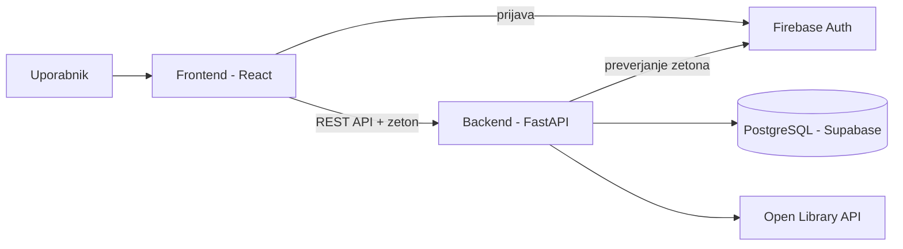

## Arhitektura

### Glavni deli sistema

- **Frontend** (React) – uporabniski vmesnik v brskalniku: iskanje, knjiznica, branje, profil, administracija.
- **Backend** (Python, FastAPI) – REST API. Tu je vsa logika
- **Podatkovna baza** (PostgreSQL na Supabase)
- **Firebase Authentication** – registracija in prijava uporabnikov.
- **Open Library API** – zunanji vir podatkov o knjigah in naslovnic.

### Komunikacija med deli

- Frontend se prijavi prek Firebase in dobi zeton (ID token).
- Frontend poslje zahteve backendu (JSON prek HTTP), zeton je v glavi `Authorization`.
- Backend preveri zeton, nato bere in pise v bazo.
- Ko uporabnik isce knjigo, ki je se ni v bazi, backend poklice Open Library in rezultat shrani v bazo. Naslednjic se knjiga prebere iz baze.
- Naslovnice frontend nalozi neposredno z Open Library (v bazi je shranjen samo URL).

### Podatkovna baza

PostgreSQL, gostovan na Supabase. Model je opisan v `03-podatkovni-model.md`

### Avtentikacija

- Registracijo, prijavo in gesla ureja Firebase Authentication. Aplikacija gesel ne hrani.
- Po prvi prijavi se v tabeli `User` ustvari zapis z istim ID-jem kot v Firebase (UID).
- Backend vsak zeton preveri s knjiznico `firebase-admin`. Vlogo (`user` / `admin`) prebere iz nase baze.
- Neprijavljen obiskovalec dobi samo javne podatke (katalog in javni profili).

## Lokalni zagon

Potrebujemo Python, Node.js, Supabase projekt (baza) in Firebase projekt (prijava). Podatki za povezavo se vpisejo v `.env` datoteki.

### Diagram

## Tehnoloski sklad

- **Frontend:** React, Vite, React Router, Tailwind CSS, Firebase JS SDK
- **Backend:** Python, FastAPI, httpx (klici Open Library)
- **Podatkovna baza:** PostgreSQL (Supabase)
- **Avtentikacija:** Firebase Authentication, `firebase-admin` na backendu
- **Lokalni razvoj:** VS Code, Git in GitHub, Thunder Client (testiranje API-ja)
- **Zunanji viri:** Open Library API

## Arhitekturne odlocitve

- **Locen frontend in backend** – vsak del ima svojo nalogo. Backend lahko testiramo sam (Thunder Client), isti API pa bi lahko kasneje uporabljala tudi mobilna aplikacija.
- **React** – zelo razsirjen, veliko primerov in dokumentacije. Aplikacija ima veliko ponavljajocih se elementov (kartice knjig, seznami, filtri), kar se lepo resi s komponentami.
- **Python in FastAPI** – Python je preprost in ima dobre knjiznice za CSV in HTTP klice, kar rabimo za uvoz iz Goodreadsa in Open Library. FastAPI sam preveri vhodne podatke in ustvari dokumentacijo API-ja.
- **PostgreSQL** – podatki so med sabo mocno povezani (delo, izdaja, knjiznica, posoje), zato je relacijska baza najbolj primerna
- **Supabase** – brezplacen gostovan PostgreSQL, zato nam ni treba postavljati lastnega streznika za bazo.
- **Firebase Authentication** – prijava in varno shranjevanje gesel sta ze resena, zato tega ne pisemo sami. Je brezplacen, enostaven za uporabo in omogoca tudi prijavo z Google racunom.
- **Klici Open Library prek backenda** – backend podatke shrani v nas katalog, zato aplikacija deluje tudi, ce Open Library ni dosegljiv, in ne klicemo API-ja za vsako iskanje znova.
