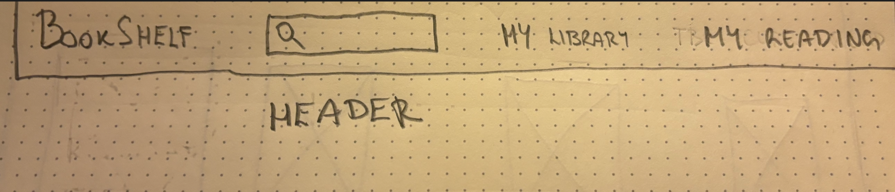
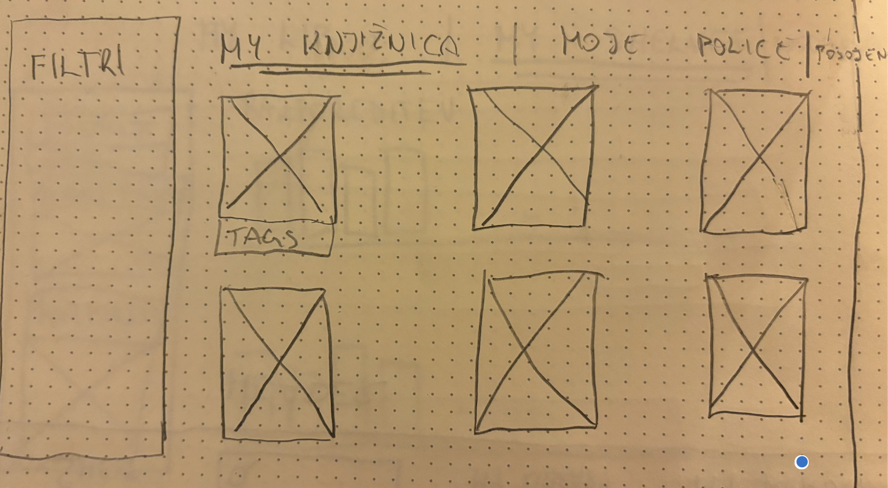
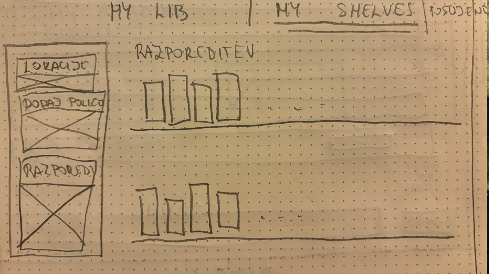
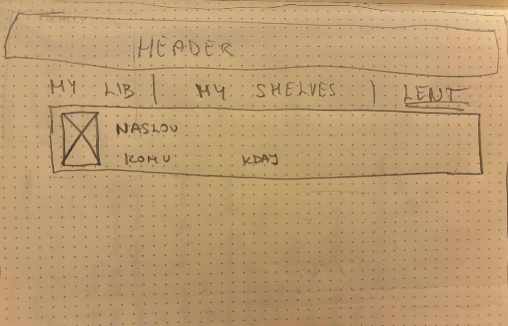
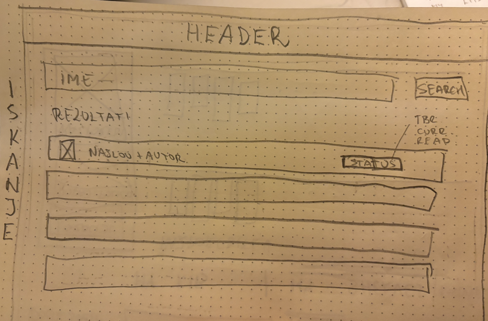
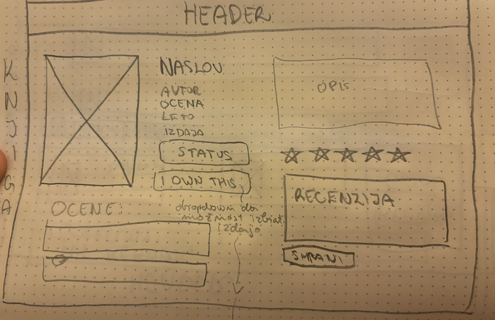
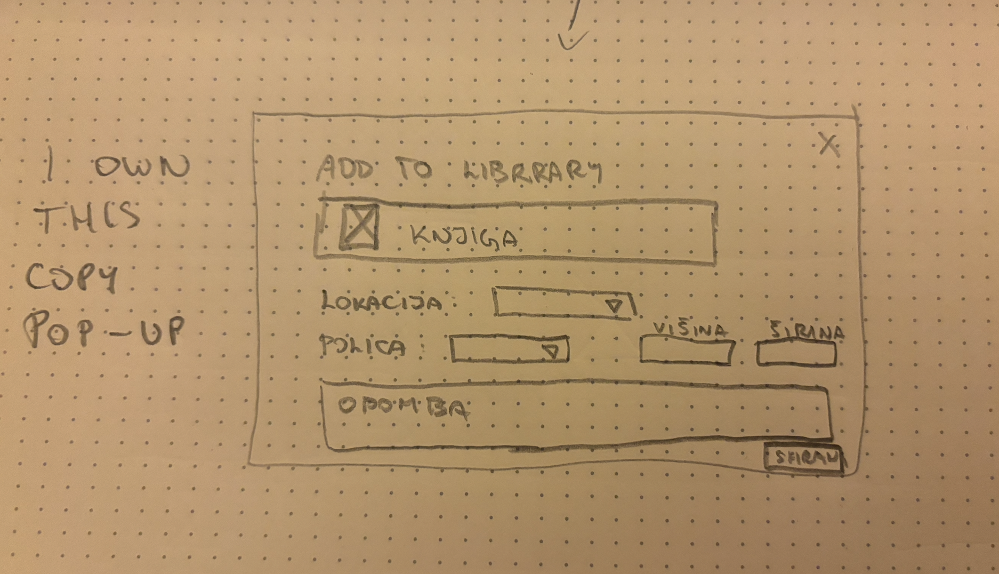
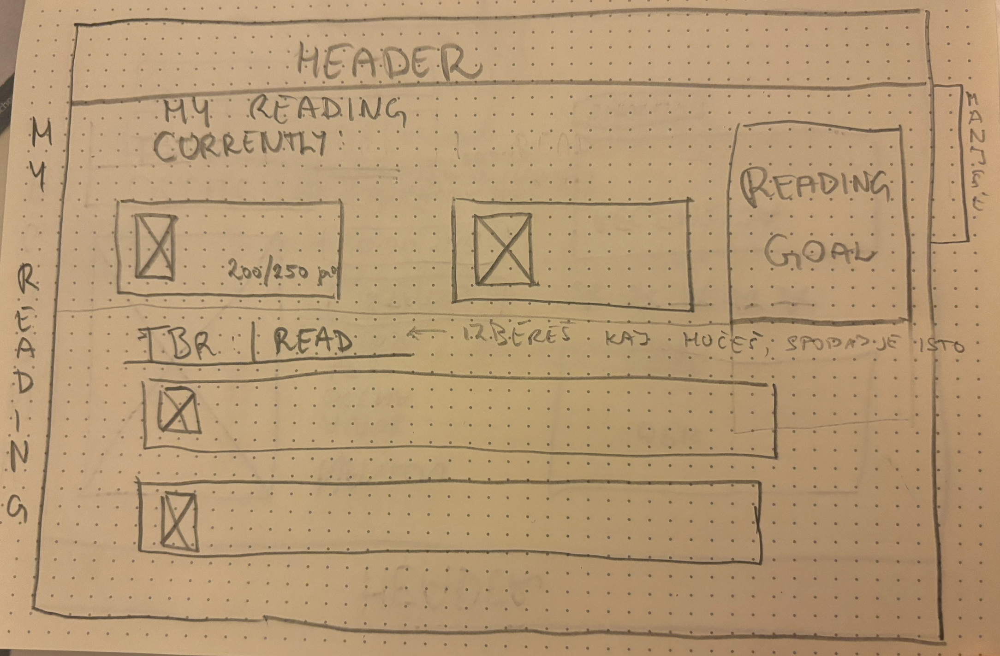

# Wireframes

## Header

Header strani, ki vkljuxuje logo, iskalno polje, mojo knjiznico in mojim branjem

## Moja knjiznica

### Moja knjiznica

moja knjiznica so knjige ki jih ima uporabnik v lasti. na prvi strani so prikazane vse knjiznice ki jih ima uporabnik v lasti. lahko jih filtrira.

### moje police

prikaz knjiznih polic, omogoca filtriranje po lokacijah in policah, ter dodajanje polic. izbira zeljene razporeditve knjig na policah

### posojene knjige

prikaz knjig ki jih je uporabnik komu posodil, z obvestilom kdaj in komu

## iskanje knjig

iz iskalnega polja v headerju odpre to stran z rezultati, kjer lahko uporabnik vidi rezultate in dela nadaljne poizvedbe

## knjiga

prikaz informacij o knjigi

### pop up - i own this book

uporabnik izbere izdajo knjige, ki jo ima v lasti. lahko poljubno doda velikost knjige, ki bo uporabna pri sortiranju knjiznih polic.

## Moje branje

na vrhu je currently reading, kartice za vsako knjigo posebej. na desni je bralni cilj za teko;e leto. v spodnji polovici zaslona pa je prikaz to be read in read, kjer lahko uporabniki vidijo relavantne knjige. prikaz je sicer enak za TBR in read.

